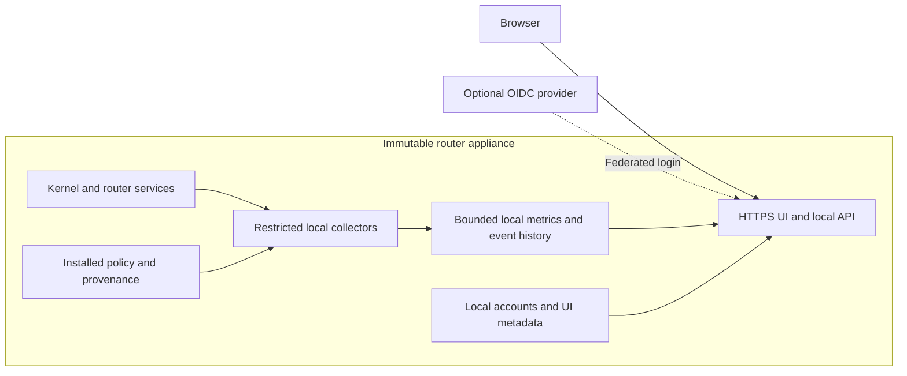

# Router web UI plan

Draft product direction, 11 October 2026.

Build a standalone network observatory into the immutable router image. Its main jobs are to show network health, explain individual device behaviour, and make the router's applied policy understandable. The complete UI, API, authentication support, collectors, and history storage run on the router. Installation must work on another compatible router without a particular site's inventory, naming, VLANs, Kubernetes cluster, monitoring stack, or identity provider.

The interface is mostly read-only. Router configuration remains owned by the image and its approved configuration mechanisms. Local UI preferences, device annotations, saved investigations, and authentication state have explicit writable storage. OAuth-based login is supported through OpenID Connect; local access provides independent setup and recovery.

**Product references and direction**

Borrow UniFi's progression from a network overview into focused topology, tables, and property panels. Its flow browser supports configurable columns, saved filters, and detail panels; its topology spotlight reduces unrelated detail during investigation. Those are useful patterns for this console. [UniFi traffic flows](https://help.ui.com/hc/en-us/articles/32201256219799-Traffic-Flows-and-Traffic-Logging-in-UniFi-Network), [UniFi topology spotlight](https://blog.ui.com/article/introducing-unifi-network-10-6).

Borrow Firewalla's device-centred investigation: select a device, inspect its conversations, open a blocked flow, and see the rule or feature responsible. Adapt that interaction to a read-only explanation of policy. [Firewalla network flows](https://help.firewalla.com/hc/en-us/articles/24739086338323-Firewalla-Feature-Network-Flows).

The console's own emphasis is evidence: what happened, which device and service were involved, what the router observed, which policy applied, and what changed beforehand. Every useful summary should lead to the underlying measurements or events.

**Standalone appliance boundary**

- Bundle frontend assets, fonts, icons, API code, and supported local adapters into the signed image. Serve the browser directly from the router over HTTPS. Core use needs no CDN, cloud account, external reverse proxy, licence check, or external database.
- Read local interfaces, routes, neighbours, leases, service status, firewall state, and available traffic metadata. A capability manifest describes what this image can expose; absent features receive a clear explanation.
- Keep storage bounded in a dedicated application area of the router's persistent data volume. Follow the appliance's encrypted-state model where provided; update immutable binaries and configuration through its approved artifact workflow.
- Run collection independently of browser sessions. Historical data continues to accumulate when nobody has the UI open, within resource and retention limits.
- Keep the UI outside the forwarding path. Stopping the UI, exhausting its storage quota, or crashing its database must leave routing, DHCP, DNS, and firewall enforcement working.
- Expose the console only on explicitly selected management interfaces and networks. Preserve management-plane separation; the UI must not introduce routing into an isolated out-of-band network.
- Optional telemetry export can come later. External services never supply a prerequisite for the core screens. Federated login is the deliberate exception: that login method needs its configured provider, while local login and the observatory remain independent.

The API consumes typed snapshots and bounded queries. Collectors receive only the privileges required for their sources; the web process has no general shell, root access, or firewall mutation capability. A privileged source that cannot be read safely gets a narrowly scoped helper. Deploying the console does not require installing a separate monitoring suite on the router.

**Navigation and everyday use**

Use a persistent desktop sidebar with seven sections. Page titles match their navigation labels, and detail pages retain the active parent section and breadcrumbs.

| Section | Route | Main question and content |
| --- | --- | --- |
| Overview | `/overview` | Is the network working, what needs attention, and what changed? |
| Devices | `/devices` | What is this device doing, and what can it reach? Searchable inventory and device details. |
| Traffic | `/traffic` | Who is communicating with whom, over which path, and with what result? |
| Network | `/network` | What interfaces, segments, routes, translations, and tunnels does this router provide? |
| Firewall | `/firewall` | What policy is installed, where did it come from, and which devices does it affect? |
| Events | `/events` | What happened before and during a problem? One correlated timeline. |
| System | `/system` | Is the appliance healthy? Image, boot, services, storage, telemetry, access, and console preferences. |

Global search accepts a device name, IPv4/IPv6 address, MAC address, domain, rule ID, or interface. A shared time selector supports live observation and historical intervals. Clicking a graph spike carries the selected interval into the device, flow, and event views. URLs preserve useful filters and time ranges; browser back returns to the previous investigation.

A side panel supports quick inspection without losing a table's position. A full detail page supports longer investigations and shareable links. Mobile prioritises current health, device search, and recent incidents; tables retain access to all fields through their detail view.

**Overview and metrics**

The opening screen should answer an operational question before showing a catalogue of counters. Give the upper portion to current incidents and the WAN's condition, the centre to aligned time-series charts, and the lower portion to affected devices and recent changes.

- **Internet quality:** upload/download throughput, measured latency and loss, link state, gateway reachability, and DNS success. Separate IPv4 and IPv6. Distinguish local link failure, upstream reachability failure, and resolver failure when evidence permits.
- **Internal traffic:** traffic by segment and interface, busiest observed devices, errors, drops, and inter-segment traffic. Label WAN and local traffic separately so an internal backup does not appear as internet consumption.
- **Router pressure:** CPU, memory, temperature where available, storage, packet-processing drops, connection tracking usage, and collector pressure. Show the bottleneck beside its likely affected path.
- **Changes:** devices first seen, address changes, link flaps, routing changes, firewall revisions, image boots, and local service failures.

Use readable charts with shared cursors, units, event markers, and comparison with a previous interval. Rates, transfer totals, sampled estimates, and probe results must be distinguishable. Show missing samples as gaps; counter resets after a reboot must not produce giant traffic spikes. Device totals need a defined accounting point and an unattributed bucket, with reconciliation against interface totals where possible.

Show measurement age independently of page refresh. An old successful probe means "last succeeded at 14:32", not "healthy now". Baseline comparisons and anomaly summaries should explain the measured deviation instead of inventing a single network health score.

**The device page**

Make this the richest screen. Its header presents a readable name, observed status, network segment, addresses, last activity, and any current issue. Use tabs for Summary, Traffic, Firewall, Addresses, and History.

The summary connects identity, activity, and reachability: bandwidth over the selected period, recent peers and destinations, blocked attempts, advertised services observed locally, and relevant router events. Open each metric into a filtered Traffic view. An optional owner, location, and note help an operator remember what an unfamiliar device is.

Preserve an address history across DHCP lease changes and IPv6 privacy addresses. Model a device separately from its interfaces, addresses, and sessions. Show the evidence behind an association: lease, neighbour observation, authentication session, or operator annotation. MAC randomisation, reused addresses, and incomplete evidence must not silently merge unrelated devices. Historical traffic is attributed using bindings valid at the time of the event.

Represent "recently observed", "lease still valid", "unreachable to a probe", and "not observed recently" separately. A sleeping device or stale neighbour entry does not prove disconnection. Vendor and application labels are hints with visible provenance, and manual aliases do not rename DHCP or DNS records.

**Per-device firewall policy and provenance**

The Firewall tab must answer both "which rules affect this device?" and "where did they come from?" It needs a first-class data contract between the router's policy producers and the UI.

Keep three concepts explicit:

1. **Installed:** a rule or set membership is present in an observed firewall revision.
2. **Applicable:** that installed policy covers this device's identity, addresses, segment, or relevant traffic. Some rules apply only to a particular protocol, destination, or connection state.
3. **Observed match:** recorded traffic or an attributed counter demonstrates a match. Applicability alone does not establish a match, and a shared rule counter is not a per-device count.

At the top, show a plain-language summary of internet access, inter-segment access, inbound exposure, and exceptions. Qualify it by address family, protocol, destination, observation time, and supported policy semantics. A lower-level table provides the actual rule path and source details.

| Field | What the operator sees |
| --- | --- |
| Effect | Allow, deny, reject, log, translate, rate-limit, or another supported action. |
| Scope | Device-specific rule, inherited group/segment rule, service exception, or router baseline. |
| Match conditions | Source/destination, IPv4/IPv6, protocol, ports, interface, state, and relevant dynamic membership. |
| Processing location | Firewall engine, table/chain or equivalent, hook, priority, and ordering context. |
| Origin | Image baseline, versioned configuration, locally applied dynamic policy, or another identified local producer. |
| Source reference | Stable logical policy ID, bundle/image revision, source file or generator, and author/approval reference when recorded. |
| Lifecycle | Applied time, last observed time, expiry/revocation where relevant, and evidence freshness. |
| Usage | Last observed match and available counters, clearly labelled as per-device or shared. |

Provide a provenance path such as **device → segment membership → inherited policy → compiled rule → installed revision**. For a locally received dynamic grant, show its producer, original source reference, and remaining lifetime without contacting the upstream system. Login to the console is separate from device firewall identity and must never imply a network-access grant.

Illustrative device view:

| Policy affecting a camera | Origin | Application |
| --- | --- | --- |
| Permit queries to the router's DNS service | Image baseline, logical policy `client-dns` | Inherited by devices on this segment. |
| Permit TCP to a recording server | Versioned policy `camera-recorder`, revision 12 | Applies to this camera's current address binding. |
| Deny other internet access | Segment policy `restricted-egress`, revision 12 | Governs remaining matching traffic on the documented rule path. |

Selecting a row opens its conditions, provenance, affected devices, relevant flow evidence, and history. Link to source text bundled with the image when available; an external repository link is supplementary. Explain a temporary rule's expiry and the policy that will remain afterward.

Preserve stable logical rule IDs during compilation. Store a secret-free provenance manifest alongside the generated policy, mapping those IDs to installed rules and dynamic sets. Record the running revision and relevant membership snapshots with history. Firewall handles and comments alone are insufficient because they can change or lack original context. Unknown or out-of-band rules remain visible as **origin unavailable**.

Offer a scoped "Explain access" query: choose device, destination, protocol, and port. Show the evaluated rule path, address translation, route, and available observed verdict. Respect jumps, returns, connection state, and multiple hooks; do not flatten the firewall into a misleading single first-match list. Distinguish predicted policy outcome from an observed decision and from successful application connectivity. Unsupported semantics or missing evidence produce a partial explanation.

**Traffic and homelab investigations**

Traffic is a searchable conversation table with source device, destination, protocol, ports, start/last activity, bytes, direction, result where known, and relevant rule. Filters include device, segment, address family, local/internet, allowed/blocked/unknown, and translated/native. Flow details show original and translated tuples when locally available.

Domains come from available resolver or protocol metadata, with their association and age visible. Encrypted DNS, encrypted application traffic, VPN tunnels, and shared hosting limit classification. The product does not promise browsing contents or identify an application solely from its port.

Useful homelab workflows include:

- **Why can't this device reach that service?** Bring together available DNS evidence, the route and translation path, relevant policy, and observed failures. A router-originated probe is labelled with its actual source; it cannot prove the device's own path works.
- **What changed before this broke?** Align a failed connection with a lease renewal, route withdrawal, policy expiry, image update, or resolver restart. Preserve the distinction between correlation and a demonstrated cause.
- **What happens across IPv4 and IPv6?** Follow dual-stack addresses, RA/prefix lifetimes, DNS64 and NAT64/NAT46 where supported, and family-specific policy. Show which parts of the path the router actually observed.
- **What is exposed?** Inventory router listeners, forwarding rules, active port mappings where supported, and inbound policy. Show configured exposure separately from externally verified reachability.
- **What depends on this device or link?** Use recorded conversations and local routes to identify known dependencies and affected destinations. An unseen dependency remains unknown.
- **Is a backup or lab job saturating the network?** Compare a device's traffic with WAN/interface pressure, latency, drops, and other active devices over the same interval.
- **Are tunnels and dynamic routes healthy?** Where present, show tunnel state, locally known peers, route advertisements/withdrawals, next hops, and affected prefixes. The UI reads router-local state and does not require a VPN controller or cluster API.
- **What happened overnight?** A locally generated daily summary highlights outages, new devices, unusual transfers, policy changes, and storage/telemetry gaps. Each item links to evidence.

The Network map centres on the router, its interfaces, segments, routes, and observed neighbours. Physical switch ports, wireless signal, roaming, and traffic entirely within a switched segment cannot be inferred reliably from a router alone. Present those as unobserved unless the router itself has an appropriate local source. Core navigation must remain useful without them.

**Visual identity**

Use a neutral product identity, provisionally **Lanrith Console**, with the configured appliance name underneath. Site branding is optional metadata. The visual character is a calm, precise instrument panel with a small route-junction mark and consistent directional notation.

| Element | Direction |
| --- | --- |
| Surfaces | Warm off-white and white in light mode; graphite and slate in dark mode. Thin dividers, modest corner radii, little shadow. |
| Accent | Deep teal for selections and navigation. Reserve green, amber, and red for labelled operational states. |
| Typography | Locally bundled humanist sans, such as IBM Plex Sans, with its mono companion for addresses, rule IDs, and numeric columns. Tabular figures in metrics. |
| Layout | Compact sidebar, a clear page title and time range, broad charts, and dense adjustable tables. Keep operational information prominent. |
| Charts | A small accessible palette, stable series colours, direct labels, visible units, and matched timelines. No decorative gauges or constantly moving traffic particles. |
| Topology | Focus on the selected device and relevant path. Reveal detail progressively; pair the diagram with an equivalent list. |
| Interaction | Keyboard navigation, visible focus, copyable identifiers, restrained transitions, reduced-motion support, and useful zoom layouts. Status never relies on colour alone. |

Use concrete copy: "DNS requests timing out", "Policy expired 3 minutes ago", or "No observations since 09:14".

**Authentication and permissions**

Support provider-neutral **OpenID Connect over OAuth 2.0**, using Authorization Code with PKCE. OIDC supplies the authentication identity; an arbitrary OAuth access token is not proof of identity. Follow the standard validation and security requirements. [OpenID Connect Core](https://openid.net/specs/openid-connect-core-1_0.html), [OAuth security best current practice](https://www.rfc-editor.org/rfc/rfc9700.html).

- Configure a trusted issuer, client identity, exact callback URI, and explicit claim-to-role mappings. Identify federated accounts by issuer and subject, not a mutable email address. No hardcoded provider or homelab group names.
- Handle the exchange in the router backend. Validate issuer, audience, signature, expiry, state, and nonce; keep credentials and tokens out of browser storage and logs. Use secure HTTP-only session cookies and CSRF protection for writes.
- Start with **Viewer**, **Operator**, and **Administrator** roles. Viewer reads permitted summaries; Operator can investigate detailed traffic, annotate devices, save investigations, and run permitted diagnostics; Administrator manages console access and retention. Enforce permissions in the API, including exports. None of these roles grants a general router shell or live firewall editor.
- Provide a locally provisioned recovery administrator with no universal default credential. Provision and recover it through the appliance's trusted setup/console path. Protect credentials in the designated local secret store, rate-limit login, and audit recovery use.
- When the provider is unavailable, new federated login fails with a clear explanation. Existing sessions follow their configured lifetime; they are not extended indefinitely. Local recovery remains usable without external DNS or the provider, using a provisioned management endpoint and certificate trust established during setup.
- Keep session revocation, login history, and locally mapped permissions visible. External role changes take effect through the defined reauthentication/session policy; the UI must not imply immediate revocation when it has no such signal.

The design protects browsing metadata, credentials, policy details, and router availability. Three concrete abuse cases guide implementation: a forged login or role claim is rejected through protocol validation and local authorization; malicious device names render as text; expensive history queries and diagnostic requests are bounded so a console user cannot monopolise forwarding resources. These controls require implementation and negative-path validation before release.

**Local collection, history, and limits**

Use a small embedded store for device identity, provenance, events, and UI metadata, plus bounded metric rollups and indexed flow segments as needed. Choose the exact storage engines after measuring expected flow volume and appliance resources. A heavyweight analytics service is not a baseline requirement.

Start by qualifying local adapters for the image's actual datapath and services. Kernel interface counters, neighbour tables, DHCP leases, firewall snapshots, and connection tracking are useful sources, but none is automatically a complete per-device flow history. Offloaded or userspace forwarding needs its own supported observation point. Flow lifecycle collection, NAT correlation, event loss reporting, and per-device accounting need explicit qualification.

Proposed retention defaults are 24 hours of fine-grained metrics, 30 days of rolled-up metrics and policy/event history, and 7 days of flow metadata where the configured disk budget allows. These are initial sizing targets. Preserve policy/binding history for at least as long as the flows that reference it. Show the actual retained interval and any eviction or sampling gap.

Collection queues, series counts, unique device/address growth, query ranges, exports, CPU, memory, and disk usage all need hard bounds. Prioritise current health over detailed history when under pressure. Reserve storage separately from essential router state and report when observations are dropped. Avoid high-cardinality destination labels in the metrics store. Do not retain packet payloads by default; DNS/flow detail access and export deserve separate permissions.

Back up local accounts, labels, preferences, and saved investigations separately from bulk telemetry. Use versioned storage formats and an A/B rollback strategy that remains compatible with the previous image; a UI schema migration must not block router recovery.

**Management within a mostly read-only UI**

Useful writable features are local aliases and notes, saved filters, investigation bookmarks, local incident acknowledgement, and console account/preferences management. These writes affect the console's own state. Acknowledging an incident does not claim the underlying fault is fixed.

Offer bounded DNS, ping, and connection checks from clearly named router interfaces in a later operator workflow. Scope allowed destinations and execution budgets; provide no arbitrary command field. Active probes are optional, so visibility remains useful without running them.

For router behaviour changes, show the owning image/configuration revision and let an operator export a proposed change or diagnostic bundle for the appliance's existing reviewed workflow. The first release has no inline rule editing, one-click traffic unblocking, image activation, or service restarts. Show desired, staged, and running revisions separately when those states are available locally.

**Delivery sequence**

| Stage | Deliverable | Completion evidence |
| --- | --- | --- |
| 1. Standalone foundation | Image-bundled UI/API, local access and OIDC, bounded storage, capability discovery, Overview, System, and basic device identity/history. | Boot on a clean compatible appliance; use the UI with external services disconnected; stop the console without disturbing forwarding. |
| 2. Device and policy visibility | Device Firewall tab, installed rule snapshots, provenance manifest, applicable policy, revision history, and qualified per-device traffic accounting. | Trace a rule from source to a device; distinguish shared counters from device matches; follow a lease/address change and rule expiry correctly. |
| 3. First useful observatory release | Flow investigation, linked timelines, observed verdicts where available, initial access explanations, exposure view, and IPv4/IPv6/translation views supported by the image. | Diagnose a known blocked connection and a known congestion incident from the UI; show missing evidence honestly. Stages 1–3 form the initial product. |
| 4. Deeper homelab workflows | Dependency views, daily summaries, expanded routing/tunnel adapters, saved comparisons, and bounded diagnostics. | Complete representative investigations on different network layouts without site-specific code or required external integrations. |

Before release, exercise provider outage, invalid/replayed login responses, denied API/export permissions, hostile device labels, stale identities, collector failure, clock changes, disk pressure, high flow churn, and reboot/rollback. Compare forwarding throughput and latency with collection enabled and disabled. Establish resource budgets before selecting a default sampling rate.

Product acceptance should include these tasks: find the device responsible for a traffic spike; explain the installed rule behind a blocked connection and its origin; compare policy before and after a failure; follow a dual-stack device without inventing an identity match; and investigate a WAN outage while the external identity provider is unreachable.

The next design artifact should cover Overview, a device page with its Firewall tab, and a flow explanation. Use generic sample networks and include stale data, unknown provenance, and provider-unavailable states. The implementation design then resolves the local collector contract, provenance schema, storage budget, and image integration.
