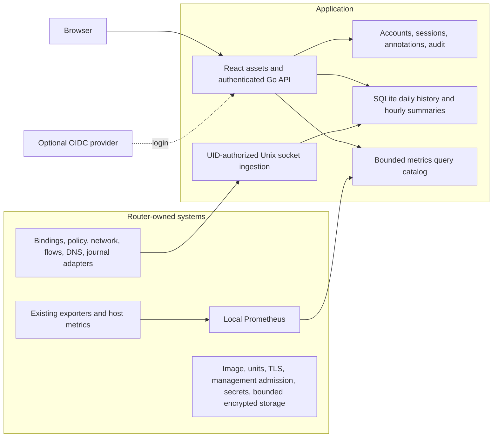

# Router Console: core systems and deployment

The console is a versioned application installed by the router build. It knows the router's supported observation contracts, but does not own the router OS or core services. It can be built, tested and previewed without a router repository or external homelab services.

| Owner | Responsibility |
| --- | --- |
| Console repository | React/TypeScript pages; local assets; Go HTTPS/API; OAuth/OIDC and recovery; API permissions; normalized ingestion; SQLite migrations, retention and sampling; bounded queries; artifact/version metadata; integration examples. |
| Router build | Install and pin the artifact; provision service identities, credentials and management addresses; native units/namespaces; TLS renewal; firewall admission; encrypted mounts and hard capacity limits; Prometheus deployment and source configuration; extend existing exporters, journal pipelines and source adapters. |
| Core component repositories | Publish qualified observations and provenance from their own internals. Policy enforcement, DHCP, DNS, packet processing and forwarding stay with their existing owners. |

Multiple explicit IPv4/IPv6 listeners and browser origins are supported. Production requires HTTPS and certificate coverage for every origin, including a recovery endpoint. Reloads retain the previous valid certificate on failure. One unavailable listener degrades the console; failure of every listener prevents console startup. The router does not depend on console readiness.

The browser uses fixed, permission-checked APIs. It cannot submit PromQL, shell commands or firewall changes. OIDC discovery is performed during login so provider failure does not prevent startup or local recovery. State, nonce and PKCE bind each login to its initiating browser and exact origin. Sessions have fixed expiry; external role changes take effect on reauthentication or local session revocation.

The application accepts secret-free observation batches over a protected Unix socket. Linux peer credentials authorize source IDs and record kinds. Observations and their acknowledged cursor commit together. Producers retry an unacknowledged batch without advancing their durable cursor. A source carries boot identity, sequence, coverage, loss and sampling metadata. Missing sources and old measurements remain visible.

SQLite separates durable account/annotation state from bulk history. Daily history tables preserve policy revisions, bindings, events, DNS and completed flows. Hourly device/source flow summaries are written before storage sampling. Seven days is the raw-detail span; high volume increases deterministic sampling across that span. Older details are sampled with summaries retained for up to 90 days. A hard filesystem ceiling and router-owned limits contain WAL, databases and the metric store. Capacity exhaustion rejects uncommitted batches rather than blocking forwarding.

The recommended router profile assigns an 8 GiB telemetry filesystem: 3 GiB Prometheus retention, a 3 GiB SQLite budget and remaining headroom. The application examples use a 2 GiB memory maximum, low CPU/IO weight, and a one-CPU quota. These are deployment inputs for qualification, not claims about measured requirements. Prometheus uses both a 90-day retention limit and its size limit; actual coverage depends on volume. No packet payload is retained.

The release artifact includes component/schema versions and checksums. Schema v1 is additive and isolated from router databases; future incompatible changes require a separate migration and rollback design. Durable state is backed up separately from disposable history. Neither a migration failure nor a console outage may become an A/B boot prerequisite.
